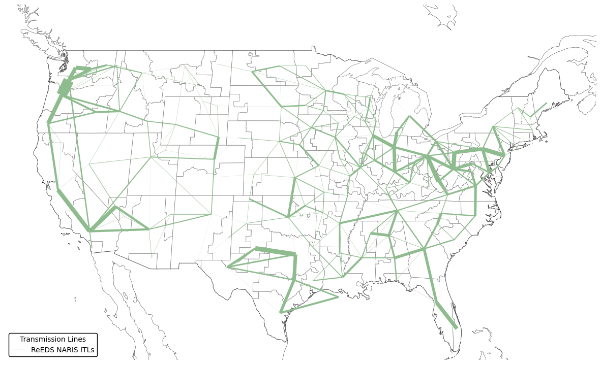
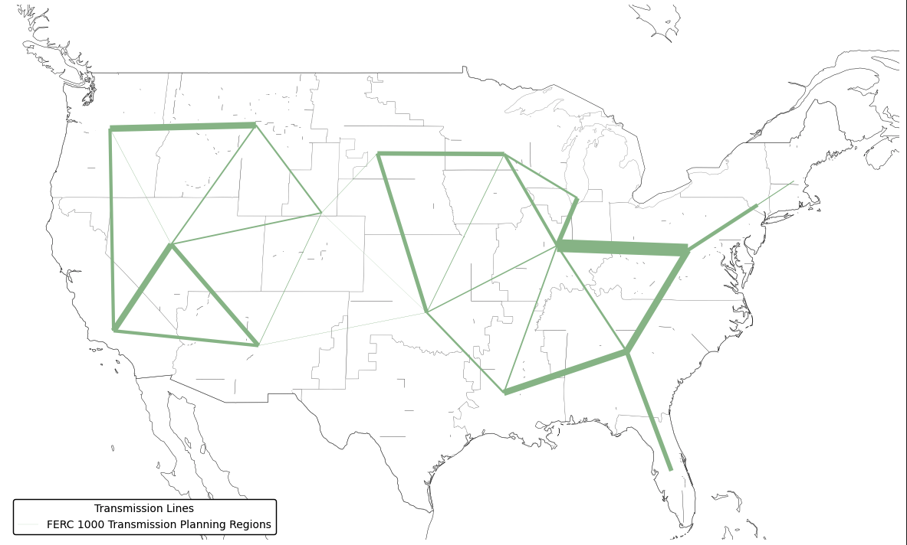
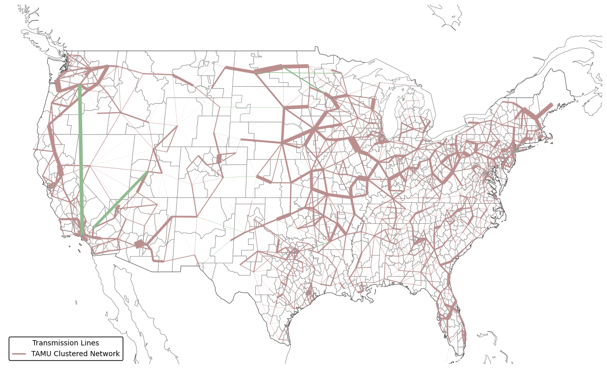
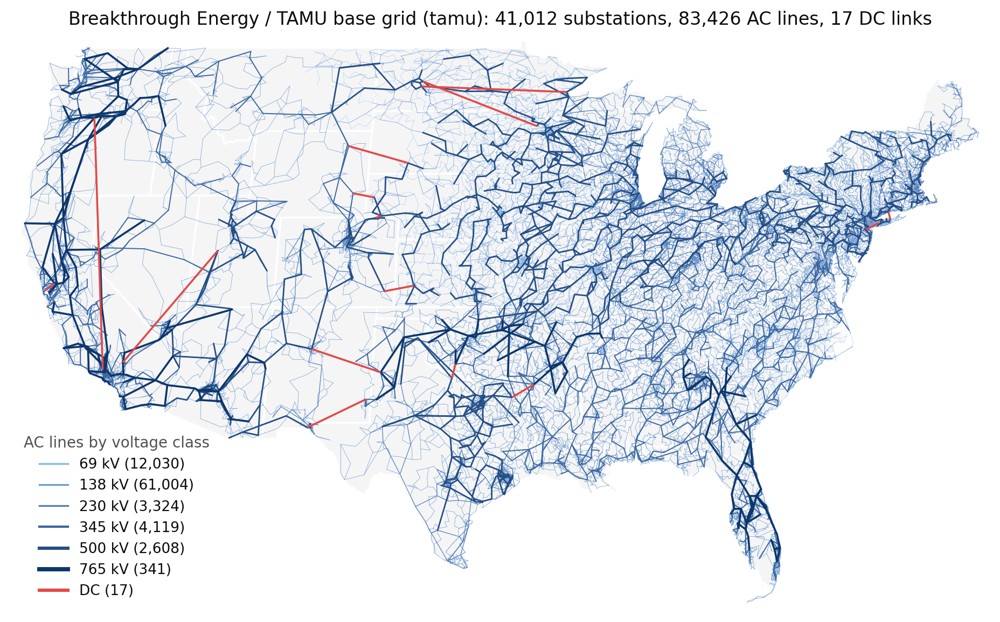
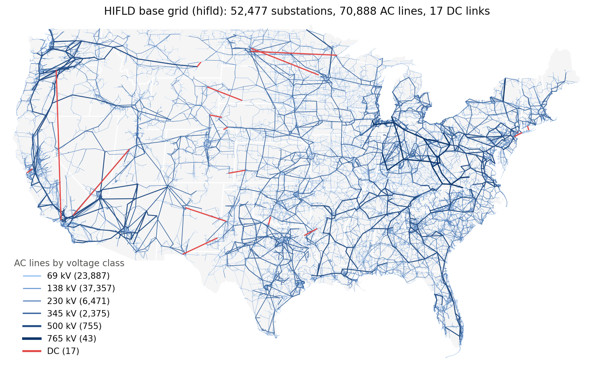

(data-transmission)=
# Transmission

## Transmission Networks

PyPSA-USA offers three transmission networks: the ReEDS NARIS-derived zonal network, the Breakthrough Energy - Texas A&M University (TAMU) synthetic nodal network, and a nodal network built from the HIFLD transmission lines.


### ReEDS NARIS-based Networks

We integrate networks at three spatial scales (County, Balance Area, and FERC 1000) derived from the North American Renewable Integration Study ([NARIS](https://www.nrel.gov/analysis/naris.html)) network. These zonal networks are derived from the non-public NARIS nodal network for the US electricity system, by the authors in [Brown et. al.](https://arxiv.org/abs/2308.03612) and [Sergi et. al.](https://research-hub.nrel.gov/en/publications/transmission-interface-limits-for-high-spatial-resolution-capacit). These networks are calculated to be N-1 contingency compliant zonal transfer capacity limits. We describe how these networks can be meshed together to create custom network topologies on the `Spatial Configuration` page.

- **County ITLs**: For higher resolution models that focus on limited spatial scopes, we integrate the county level ITLs which contain 3,108 zones across the United States.
- **ReEDS Balancing Authorities**: The ReEDS balancing authority (BA) network has 134 zones across the United States boundaries (133 of which appear in the shipped BA interface table) and can be mapped to balancing authorities, NERC regions, and RTOs/ISOs. Smaller Balancing authorities are not individually represented in this network. For example, BANC is combined into the CAISO north region.
- **FERC 1000 Planning Regions**: The FERC 1000 network splits up FERC 1000 transmission planning regions in to 17 sub-regions and nodes for the United States. These 17 regions are supersets of the ReEDS Balancing Authorities, and respect state borders to enable enforcement of regional policy constraints.







### TAMU Synthetic Nodal Network

The **TAMU synthetic nodal network** offers a high-resolution representation of the US power system, specifically designed for operational simulations. See the [Xu. et al.](https://arxiv.org/abs/2002.06155) paper for a detailed description of the network. This network includes:

- **High Spatial Resolution**: Comprising 82,549 buses, 41,561 substations, 83,497 AC lines, and 17 HVDC lines, it provides a detailed view of a synthetic transmission network.
- **DC Power Flow**: Provides data for DC-power flow approximation.
- **Clustering**: Due to its high resolution, the TAMU network is not suitable for capacity expansion planning without clustering. As part of the PyPSA-USA workflow the network is clustered with the `kmeans` and `modularity` algorithms supported by `cluster_network`; the kmeans approach follows the network-clustering methods developed by [M. Frysztracki et. al.](https://energyinformatics.springeropen.com/articles/10.1186/s42162-022-00187-7) and integrated into the PyPSA package.

While representative of the US electricity system, the TAMU network is synthetic and not precisely aligned with the actual US transmission network. As such we integrated the ReEDS NARIS dataset for planning applications where more precise inter-regional transfer capacity ratings are necessary.




### HIFLD Nodal Network

`model_topology: transmission_network: hifld` builds the nodal network from the HIFLD "Electric Power
Transmission Lines" layer (Oak Ridge National Laboratory and U.S. Department of Homeland Security), so
lines follow their surveyed routes and voltages instead of TAMU's synthetic corridors. Power flow and
clustering work as for `tamu`; the grid is built nationally by `build_hifld_grid` and then filtered by
interconnection. From the 2024-09-30 data it has 52,477 substations, 59,948 buses, 70,888 AC lines
(873,000 route-km) and 7,471 transformers.

- **Data**: `retrieve_hifld_transmission_lines` downloads the layer from Esri's public archive of the
  last HIFLD Open version (data updated 2024-09-30, 94,619 records; HIFLD Open was shut down on
  2025-08-26). Records without a voltage or voltage class, and lines under construction or inactive,
  are dropped; a missing voltage takes the representative voltage of its voltage class.
- **Substations**: line endpoints within 200 m form one substation, with one bus per voltage class
  (69, 138, 230, 345, 500 and 765 kV) and a transformer between adjacent classes.
- **Interconnections**: each substation takes the interconnection of the nearest TAMU substation,
  smoothed over the line graph. AC lines that join two interconnections are cut (on the ground they
  are DC ties), lines with an end outside the United States are dropped, and only the largest
  connected component of each interconnection is kept. When `model_topology: include` cuts the grid,
  buses left in islands at the footprint boundary are merged into the nearest substation of the main
  network.
- **Electrical parameters**: per-km resistance, reactance and susceptance, and the per-circuit rating,
  are the medians of the TAMU lines of the same voltage class, applied over the route length.
- **Other inputs**: bus load weights come from county population. TAMU's DC ties, its hydro plants and
  its offshore wind points of interconnection, and the NREL capacity caps (keyed by TAMU substation),
  are moved to the nearest HIFLD bus or substation.
- **Limitations**: line ratings are not calibrated to the ReEDS interface capacities, as `tamu`'s are,
  and EGS, whose supply curves are keyed by TAMU substation, is not supported.






```{note}
See the [Spatial Configuration](./config-spatial.md) page for information on how to choose between networks.
```

## Interface Transmission Limits

The path-by-path ratings above are complemented by **interface** limits: aggregate MW caps on
the total simultaneous flow across a bundle of paths. PyPSA-USA ships the CPUC RESOLVE
interface table at `workflow/repo_data/config/policy_constraints/transmission_interface_limits.csv`,
which rates the CAISO import/export capability against the rest of WECC. Override it with
`electricity: transmission_interface_limits`:

| Interface | `region_1` (inside) | `region_2` (outside) | `flow_12` (MW) | `flow_21` (MW) |
| --- | --- | --- | --- | --- |
| `CA_NW` | p9, p10, p11 | p2, p5, p6, p7, p8 | 3,592 | 9,269 |
| `CA_SW` | p9, p10, p11 | p12, p13, p25, p27, p28, p30 | 10,901 | 10,463 |
| `CAISO_Imports` | p9, p10, p11 | all of the above | 9,728 | 10,208 |

**Flow orientation:** `flow_12` is the cap on flow *out of* `region_1` (exports), `flow_21` the
cap on flow *into* `region_1` (imports). Enable the table with
`model_topology: interface_transmission_limits: true`; the constraint formulation is described
in [Model Constraints](./model-constraints.md#interface-transmission-limits).

```{warning}
The interface caps are applied to the virtual `imports` / `exports` links created by
`add_extra_components`, so they bind only when `electricity: imports` / `electricity: exports`
are enabled, and they only see flow that crosses the boundary of the modeled footprint.

`p8` (northeastern California) appears in the `region_2` list of every RESOLVE row but is
itself a California zone. In a California-only model it is therefore *inside* the network, and
the internal `p8`-`p9` AC corridor — about 300 MW in the ReEDS/NARIS balancing-area table —
carries no trade links and escapes the `CAISO_Imports` cap. Simultaneous CAISO imports are
understated by roughly that amount. This gap is documented rather than corrected: closing it
would require constraining internal AC lines alongside the trade links.
```

(transmission-data)=
### Data
```{eval-rst}
.. csv-table::
   :header-rows: 1
   :widths: 22,22,33
   :file: datatables/transmission.csv
```
